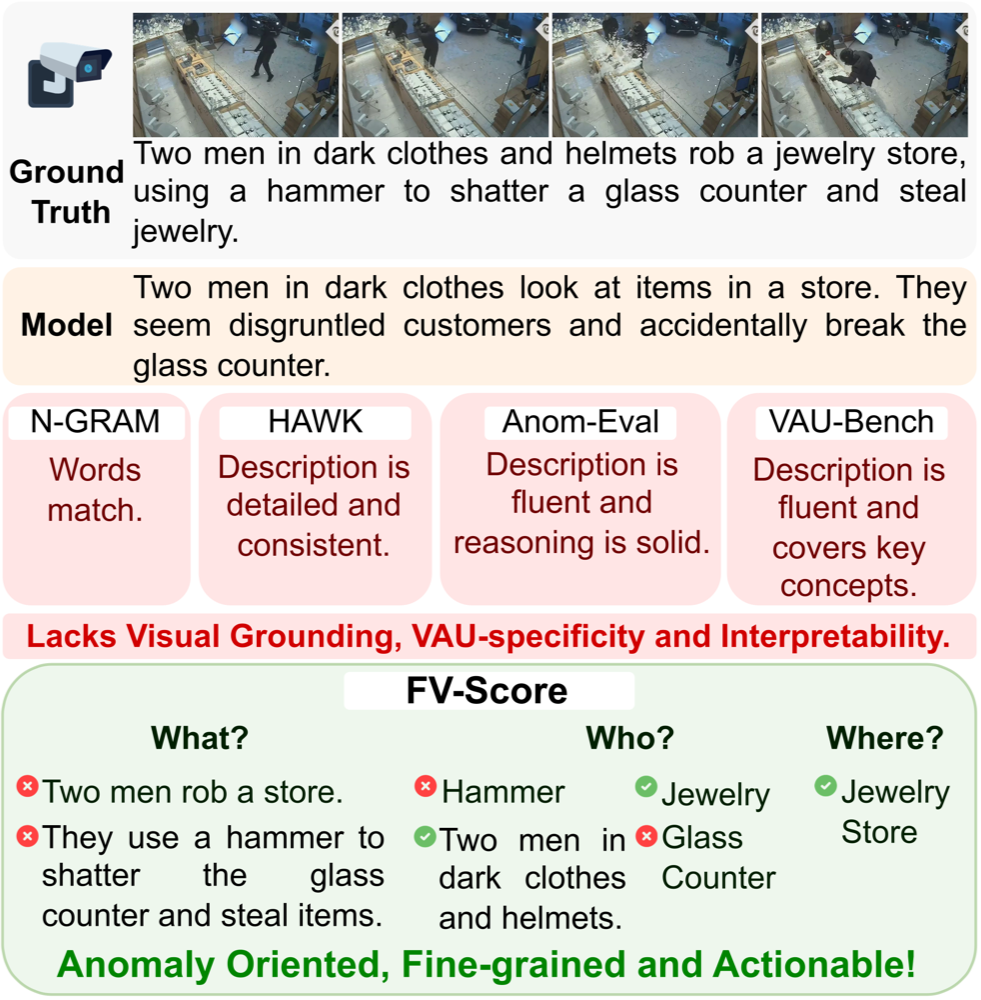

<div align="center">

# FineVAU: A Novel Human-Aligned Benchmark for Fine-Grained Video Anomaly Understanding

**AAAI 2026**

[João Cardeira Pereira](https://scholar.google.pt/citations?user=37YRVtAAAAAJ)<sup>1,2,4</sup>,
[Vasco Lopes](https://scholar.google.pt/citations?user=bvYBcRkAAAAJ)<sup>1,2,3</sup>,
[João Neves](https://scholar.google.pt/citations?user=U1cK384AAAAJ)<sup>1,3</sup>,
[David Semedo](https://scholar.google.pt/citations?user=O8mUEM8AAAAJ)<sup>1,4</sup>

<sup>1</sup>NOVA LINCS &nbsp; <sup>2</sup>DeepNeuronic &nbsp; <sup>3</sup>University of Beira Interior &nbsp; <sup>4</sup>NOVA FCT

[](https://finevau.github.io)
[](https://ojs.aaai.org/index.php/AAAI/article/view/37790)
[](https://arxiv.org/abs/2601.17258)
[](https://huggingface.co/datasets/joao-cardeira/FineW3)
[](LICENSE)



</div>

## Abstract

Video Anomaly Understanding (VAU) is a novel task focused on describing unusual occurrences in videos. Despite growing interest, the evaluation of VAU remains an open challenge. Existing benchmarks rely on n-gram-based metrics (e.g., BLEU, ROUGE-L) or LLM-based evaluation. The first fails to capture the rich, free-form, and visually grounded nature of LVLM responses, while the latter focuses on assessing language quality over factual relevance, often resulting in subjective judgments that are misaligned with human perception. In this work, we address this issue by proposing FineVAU, a new benchmark for VAU that shifts the focus towards rich, fine-grained and domain-specific understanding of anomalous videos. We formulate VAU as a three-fold problem, with the goal of comprehensively understanding key descriptive elements of anomalies in video: events (*What*), participating entities (*Who*) and location (*Where*). Our benchmark introduces a) FV-Score, a novel, human-aligned evaluation metric that assesses the presence of critical visual elements in LVLM answers, providing interpretable, fine-grained feedback; and b) FineW³, a novel, comprehensive dataset curated through a structured and fully automatic procedure that augments existing human annotations with high quality, fine-grained visual information. Human evaluation reveals that our proposed metric has a superior alignment with human perception of anomalies in comparison to current approaches. Detailed experiments on FineVAU unveil critical limitations in LVLM's ability to perceive anomalous events that require spatial and fine-grained temporal understanding, despite strong performance on coarse grain, static information, and events with strong visual cues.

## Overview

This repository contains the evaluation code: an LVLM describes each FineW³ video, a judge (FineVAU-Judge) scores each
description against the ground truth, and the scores are combined into FV-Score. Both models run locally on
[vLLM](https://github.com/vllm-project/vllm).

| | Default |
|---|---|
| LVLM | [`Qwen/Qwen3.5-9B`](https://huggingface.co/Qwen/Qwen3.5-9B) |
| Judge | [`google/gemma-4-31B-it`](https://huggingface.co/google/gemma-4-31B-it) |
| Prompts | [`prompts.py`](prompts.py) |
| Metric | [`scoring.py`](scoring.py) |

## Installation

```bash
pip install -r requirements.txt
```

The annotations are loaded from the Hugging Face hub ([`joao-cardeira/FineW3`](https://huggingface.co/datasets/joao-cardeira/FineW3)).
The videos are the original UCF-Crime videos, in one directory, named `{video_id}.mp4`.

## Usage

```bash
python run_evaluation.py generate --video-dir /path/to/videos
python run_evaluation.py judge
python run_evaluation.py score
```

| Stage | Output |
|---|---|
| `generate` | the LVLM's answers, in `predictions.jsonl` |
| `judge` | the judge's scores, in `judgments.jsonl`, and FV-Score |
| `score` | FV-Score again from `judgments.jsonl` (for example with other weights), without a GPU |

Interrupted runs resume where they stopped. See `python run_evaluation.py <stage> --help` for all options.

## Evaluation protocol

Each video is answered k = 4 times by the LVLM, with the sampling settings recommended on its model card. Only the final
answer is evaluated, not the reasoning. FineVAU-Judge then scores every ground-truth element of the video:

| Dimension | Elements | Score |
|---|---|---|
| What | events | 0, 0.5 or 1 |
| Who | entities and their attributes | 0 or 1 |
| Where | scene attributes | 0 or 1 |

FV-Score is the weighted share of points obtained, with λ<sub>what</sub> = 1, λ<sub>who</sub> = 2 and
λ<sub>where</sub> = 1, averaged over the k answers of each video. The paper used Gemini-2.5-Flash as the judge, so scores
from this code are not directly comparable with the paper's tables.

## License

Apache License 2.0. The videos are not distributed with this repository.

## Citation

```bibtex
@inproceedings{pereira2026finevau,
  title={FineVAU: A Novel Human-Aligned Benchmark for Fine-Grained Video Anomaly Understanding},
  author={Pereira, Joao Alexandre Cardeira and Lopes, Vasco and Neves, Joao C and Semedo, David},
  booktitle={Proceedings of the AAAI Conference on Artificial Intelligence},
  volume={40},
  number={10},
  pages={8403--8411},
  year={2026}
}
```
